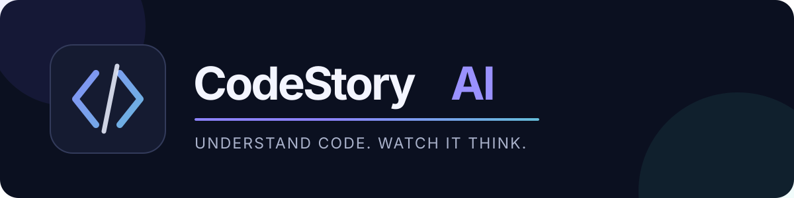
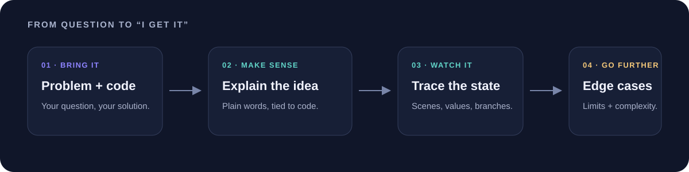
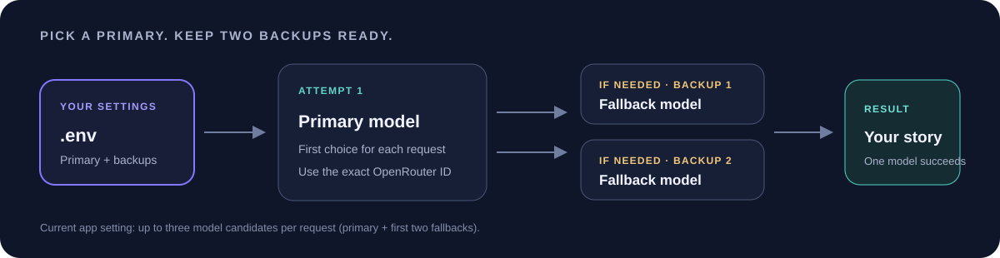
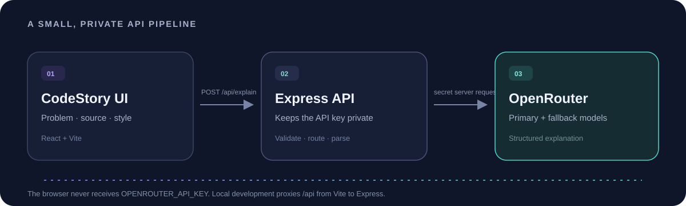

<div align="center">
  
  <br />
  <p><strong>Turn a coding problem and your solution into a clear, visual, step-by-step explanation.</strong></p>
  <p>
    <a href="#quick-start">Install</a> ·
    <a href="#configure-openrouter">Connect OpenRouter</a> ·
    <a href="#choose-multiple-models">Choose models</a> ·
    <a href="#api-guide">API guide</a>
  </p>
</div>

<p align="center">
  
</p>

## What is CodeStory?

CodeStory AI is a local-first learning tool for understanding code. Paste a problem and a solution to get a plain-language problem summary, intuition, an animated visual story, an execution trace, line-by-line notes, edge cases, complexity analysis, and interview prompts.

Stories are saved in the current browser’s local storage. The app uses the browser’s built-in speech synthesis for read-aloud. Your OpenRouter key stays on the server in `.env`; it is never sent to the browser.

## Features

- Explain code in Simple, Visual, Interview, Deep Dive, or Line by Line styles.
- Follow four animated visual scenes and a selectable execution trace.
- Review source-aware line explanations, edge cases, and complexity.
- Listen to the current scene using browser text-to-speech.
- Reopen recent explanations from local browser history; export a story as Markdown.
- Route requests through an OpenRouter model chain, keeping provider secrets server-side.

## Requirements

- Node.js **20.19+** or **22.12+** and npm. These are the supported Node versions for the Vite version used by this project. See the [Vite getting-started guide](https://vite.dev/guide/).
- An [OpenRouter API key](https://openrouter.ai/settings/keys) for live AI explanations.
- Internet access when generating an explanation.

## Quick start

```bash
git clone https://github.com/YOUR_GITHUB_USERNAME/codestory-ai.git
cd codestory-ai
npm ci
```

Copy `.env.example` to `.env`, then add your OpenRouter key and model preferences:

```bash
cp .env.example .env
```

On Windows PowerShell, use `Copy-Item .env.example .env` instead. Open `.env` in a text editor and replace the placeholder key. Then start the app:

```bash
npm run dev
```

Open <http://localhost:5173>. Vite serves the React app and proxies `/api` requests to the Express API on port `8787`.

### Available scripts

| Command | Purpose |
| --- | --- |
| `npm run dev` | Start Vite and the Express API for local development. |
| `npm run build` | Create the production frontend in `dist/`. |
| `npm start` | Start the Express API (and serve `dist/` when `NODE_ENV=production`). |

Production example:

```bash
npm run build
```

macOS/Linux:

```bash
NODE_ENV=production npm start
```

Windows PowerShell:

```powershell
$env:NODE_ENV = "production"
npm start
```

## Configure OpenRouter

CodeStory calls OpenRouter from `server.js`, not from client-side JavaScript. Set these values in `.env` and restart the server after changes:

```dotenv
OPENROUTER_API_KEY=your_openrouter_key_here
OPENROUTER_MODEL=cohere/north-mini-code:free
OPENROUTER_FALLBACK_MODELS=inclusionai/ling-3.0-flash-sante:free,poolside/laguna-s-2.1:free
PORT=8787
```

`OPENROUTER_MODEL` is tried first. The fallback value is a comma-separated list of model IDs, tried in order. To keep retries responsive, this app currently tries at most **three candidates total**: the primary and the first two fallbacks. Each candidate is routed to a higher-throughput provider when OpenRouter has multiple providers for it.

Free model access is rate-limited by OpenRouter and availability can vary. If you reach the free daily allowance, wait for the quota to reset or use an API account with available credits. CodeStory does not bypass provider limits. A paid model can incur charges; check its current price and your OpenRouter account settings before selecting it.

### Keep your key private

- Put the key only in `.env` on the server.
- Never add the key to `src/`, a `VITE_*` variable, a screenshot, or a commit.
- `.env` is ignored by Git. `.env.example` contains placeholders only.
- If a key is accidentally committed, revoke it in OpenRouter and create a replacement.

## Choose multiple models

Use OpenRouter’s [model search](https://openrouter.ai/models) to find model IDs. You can filter for free models or search by provider, model name, context length, and supported features. The [free model collection](https://openrouter.ai/collections/free-models/) is a useful starting point.

1. Search for a model and open its detail page.
2. Check the model’s price, context/output limits, supported parameters, and current provider availability.
3. Copy the API model ID shown on that page (for example, `cohere/north-mini-code:free`). Use the exact ID, including `:free` when present.
4. Put your preferred model in `OPENROUTER_MODEL`.
5. Add other model IDs to `OPENROUTER_FALLBACK_MODELS`, separated by commas and with no quotes.
6. Save `.env` and restart `npm run dev`.

Example with several choices:

```dotenv
OPENROUTER_MODEL=cohere/north-mini-code:free
OPENROUTER_FALLBACK_MODELS=inclusionai/ling-3.0-flash-sante:free,poolside/laguna-s-2.1:free,google/gemma-4-31b:free
```

The server deduplicates IDs and currently attempts only the primary plus the first two fallback IDs to avoid long wait chains. Put your best and most available choices first. OpenRouter’s [Models API documentation](https://openrouter.ai/docs/api/api-reference/models/get-models) describes how to search and inspect model IDs programmatically.

<p align="center">
  
</p>

## API guide

The browser sends the problem, code, language, and explanation style to the local Express server. The server adds the secret OpenRouter key, calls the configured models, validates the response, and returns the explanation. Do not call OpenRouter directly from the browser, because that would expose the API key.

### Check that the API is configured

```bash
curl http://localhost:8787/api/health
```

Example response:

```json
{"ready":true}
```

`ready` only means the server found an API key; it does not guarantee that the key has credits or that a model is available.

### Request an explanation

```bash
curl -X POST http://localhost:8787/api/explain \
  -H "Content-Type: application/json" \
  -d '{
    "question": "Given an integer array and a target, return the indices of two values that add up to the target.",
    "code": "function twoSum(nums, target) {\\n  const seen = new Map();\\n  for (let i = 0; i < nums.length; i++) {\\n    const need = target - nums[i];\\n    if (seen.has(need)) return [seen.get(need), i];\\n    seen.set(nums[i], i);\\n  }\\n  return [];\\n}",
    "language": "JavaScript",
    "mode": "Simple",
    "instructions": "Explain like I am new to maps."
  }'
```

The request fields `question` and `code` are required. `language`, `mode`, and `instructions` are optional. On success the API returns `{ "explanation": { ... }, "model": "provider/model-id" }`. On failure it returns an `{ "error": "..." }` message with an HTTP status such as `400` (missing inputs), `429` (provider quota), `502` (provider response), or `504` (timeout).

### Use the local API from another client

```js
const response = await fetch('http://localhost:8787/api/explain', {
  method: 'POST',
  headers: { 'Content-Type': 'application/json' },
  body: JSON.stringify({
    question: 'What does this function do?',
    code: 'const square = n => n * n;',
    language: 'JavaScript',
    mode: 'Simple',
    instructions: ''
  })
});

const result = await response.json();
if (!response.ok) throw new Error(result.error);
console.log(result.explanation, result.model);
```

## How the request flows

<p align="center">
  
</p>

## Privacy and limitations

- Explanations are stored in the browser’s local storage on that device. Clearing browser data removes that history.
- Problem statements and source code are sent to OpenRouter when you request an explanation. Review OpenRouter’s [privacy policy](https://openrouter.ai/privacy) and the selected model/provider terms before sending sensitive code.
- CodeStory explains code; it does not compile or execute submitted code.
- Model output and free-model availability can vary. Check important explanations against the source code and tests.
- Read-aloud depends on speech synthesis voices available in the browser and operating system.

## Repository name and `.gitignore`

Recommended GitHub repository name: **`codestory-ai`**. It is short, lowercase, easy to type, and matches the product name. GitHub URL: `https://github.com/YOUR_GITHUB_USERNAME/codestory-ai`.

The included `.gitignore` excludes dependencies, build output, local environment files, logs, editor files, and OS metadata while keeping `.env.example` versioned.

## Tech stack

- React and Vite for the single-page interface.
- Express for the private server-side API proxy.
- OpenRouter for model discovery and inference.
- Browser `localStorage` for saved explanations and Web Speech API for read-aloud.
- Lucide React and Motion for icons and interface animation.

## License

No license file is included yet. Add a `LICENSE` before presenting this repository as open source; without one, normal copyright restrictions apply.
